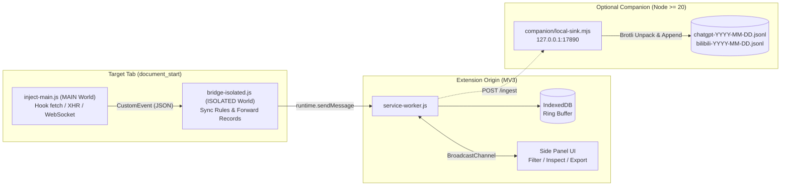

# PacketLedger

**Zero-Banner Chrome Manifest V3 Network Logger & Real-Time JSONL Sink**

[](./manifest.json)
[](./companion/local-sink.mjs)
[](./LICENSE)

PacketLedger 是一款零第三方依赖的 Chrome Manifest V3 侧边栏接口抓包与持续日志扩展。它在不挂载 `chrome.debugger`（无网页顶部黄色调试警告条）、不篡改浏览器原生 TLS 指纹的前提下，旁路捕获页面 `fetch`、`XMLHttpRequest` 与 `WebSocket` 流量，支持浏览器 `IndexedDB` 持久化与本地磁盘 `.jsonl` 实时追加写入。

内置针对 **ChatGPT 网页端对话流（POST `text/event-stream` 自动拼句）**、**Bilibili 网页端业务接口（自动剔除 `.m4s` 视频流噪音、解析直播间 16 字节头压缩弹幕帧）** 以及 **任意自定义 URL / 正则定向抓取** 的规则预设。

---

## 为什么做这个工具

在 Chrome 废除 `webRequest` 读取响应体能力后，现有网页抓包方案普遍卡在三个工程痛点上：

| 方案类型 | 代表工具 | 实际痛点 | PacketLedger 的解法 |
| :--- | :--- | :--- | :--- |
| **`chrome.debugger` 扩展** | 各类 HAR Exporter 插件 | 一旦开启，每个标签页顶部强制弹出无法隐藏的黄色调试警告条；只能测完手动点下载整包 `.har`，无法后台增量刷盘 | 采用 `document_start` 双世界注入（`MAIN` + `ISOLATED`），**零调试黄条**，支持实时流式写入本地 `.jsonl` |
| **本地 MITM 中间人代理** | `mitmproxy` / `whistle` / `Charles` | 需安装并信任系统级 CA 根证书；代理重建上游 TLS 握手会改变 JA3/JA4 指纹，抓 `chatgpt.com` 极易触发 `403` 风控 | 请求完全由原生 Chrome BoringSSL 直接发出，零证书配置、零指纹副作用 |
| **JS Mock 拦截插件** | `ajax-interceptor` / `ajax-tools` | 主打篡改响应而非持续日志；未处理 `fetch` SSE 流式分片拼接，遇到 B站 `.m4s` 音视频分片容易撑爆内存 | 通过 `response.clone()` 异步旁路读取 SSE 流且不阻塞前端打字机渲染；内置音视频分片过滤与二进制帧解析 |

---

## 工作架构



---

## 核心特性

1. **无阻塞流式 SSE 自动拼句**：针对 `POST` 发起的 `text/event-stream` 接口（如 ChatGPT `/backend-api/conversation`），异步消费克隆流并将增量 delta 自动拼合为可读的 `sseSummary.extractedText`，即使中途点击停止生成也能完整保留中断前已到达的全部文本分片。
2. **B站网页端降噪与直播帧解包**：自动放行 `api.bilibili.com`、`api.live.bilibili.com`、`passport.bilibili.com`、`vc.bilibili.com`，剔除 `*.bilivideo.com` 下的 `.m4s` 媒体分片与埋点请求；自动解析 `wss://broadcastlv.chat.bilibili.com/sub` 的 16 字节大端二进制包头（浏览器内直接解压 `ver=2` Deflate 子包，配合 `local-sink.mjs` 自动解压 `ver=3` Brotli 弹幕包）。
3. **双维度特定链接定向记录**：切换到特定链接定向记录预设后，可选择**匹配请求接口 URL**（跨页面盯紧某一个 API）或**匹配所属页面 URL**（记录指定网页生命周期内触发的所有接口），支持子串与 `/regex/flags` 正则。
4. **首屏零竞态缓冲**：`inject-main.js` 在 `document_start` 阶段即建立 `earlyBuffer` 队列，消除异步读取 `chrome.storage.local` 期间的数毫秒首屏请求漏抓窗口。
5. **敏感头一键脱敏**：开启侧边栏**脱敏头**开关后，落盘与导出前自动掩码 `Authorization`、`Cookie`、`Set-Cookie`、`X-CSRF-Token` 与 `bili_jct`。

---

## 60 秒快速上手

### 1. 安装扩展到 Chrome / Edge / Brave

- **方式 A（直接下载 Release 包）**：前往本仓库 [Releases](../../releases) 下载最新 `packet-ledger-v1.0.0.zip` 并解压。
- **方式 B（克隆源码）**：
  ```bash
  git clone https://github.com/Cybing521/packet-ledger.git
  ```

打开浏览器访问 `chrome://extensions/`，开启右上角**开发者模式**，点击左上角**加载已解压的扩展程序**，选择解压后的 `packet-ledger` 目录。点击浏览器工具栏上的扩展图标即可在右侧呼出 **PacketLedger** 侧边栏。

### 2. 导出或开启本地磁盘实时写入（可选）

- **仅在浏览器内使用**：无需运行任何命令行工具，抓到的报文自动保存在扩展 `IndexedDB` 中，随时可在侧边栏检索、查看请求头/载荷/响应正文，或点击**导出 .jsonl** 下载归档。
- **实时追加写入本地硬盘**：受浏览器沙盒约束，扩展无法直接静默写入任意磁盘路径。如需长时间挂机实时刷盘，在终端运行零依赖伴侣脚本（需 Node.js 20+）：
  ```bash
  node companion/local-sink.mjs --dir=./logs
  ```
  随后打开侧边栏上的**实时落盘**开关，命中规则的每一条请求都会按站点自动追加写入 `./logs/<siteTag>-YYYY-MM-DD.jsonl`。

---

## 日志字段结构与命令行分析示例

每行 `.jsonl` 为一条独立 JSON 对象，核心字段如下：

```json
{
  "id": 42,
  "siteTag": "chatgpt",
  "transport": "fetch",
  "capturedAt": "2026-11-24T10:30:12.410Z",
  "pageUrl": "https://chatgpt.com/c/...",
  "url": "https://chatgpt.com/backend-api/f/conversation",
  "method": "POST",
  "status": 200,
  "mimeType": "text/event-stream; charset=utf-8",
  "durationMs": 4820,
  "promptPreview": "请解释 TCP 拥塞控制",
  "sseSummary": {
    "sseEventCount": 96,
    "extractedText": "TCP 拥塞控制通过慢启动、拥塞避免、快重传和快恢复四个核心阶段..."
  },
  "requestHeaders": {},
  "requestBody": "{...}",
  "responseHeaders": {},
  "responseBody": "event: delta\ndata: ..."
}
```

配合 `jq` 快速抽提历史问答或接口耗时：

```bash
# 提取 ChatGPT 历史提问与拼合后的完整回复
jq -c 'select(.sseSummary.extractedText != null) | {capturedAt, prompt: .promptPreview, reply: .sseSummary.extractedText}' logs/chatgpt-*.jsonl

# 统计 B站接口状态码与最慢的 10 个请求
jq -r '[.durationMs, .status, .method, .url] | @tsv' logs/bilibili-*.jsonl | sort -rn | head -n 10
```

---

## 适用边界与安全声明

1. **捕获边界**：本扩展通过页面 `MAIN` 世界挂钩捕获 JS 发起的 `fetch`、`XMLHttpRequest` 与 `WebSocket` 业务请求，不拦截浏览器地址栏首屏顶层文档的 `HttpOnly` `Set-Cookie` 响应头，也不抓取 `` / `<script>` 纯静态资源请求。
2. **数据隐私**：所有抓包数据 100% 存储在你本机的浏览器 `IndexedDB` 或你自行启动的 `127.0.0.1` 本地脚本目录中，不包含任何远程遥测或外部网络上传。未开启**脱敏头**时，导出的 `.jsonl` 可能包含当前登录态凭据，请勿将原始抓包日志上传至公开仓库。
3. **合规使用**：本工具仅用于开发者调试自有账号会话、前端接口联调与个人数据归档。

---

## 本地自检测试

仓库内置零依赖自检脚本，一键验证 Manifest V3 规范、PNG 图标头尺寸、全部模块语法及 B站 Brotli 压缩帧落盘解包：

```bash
node scripts/smoke-test.mjs
```

## License

[MIT](./LICENSE)
